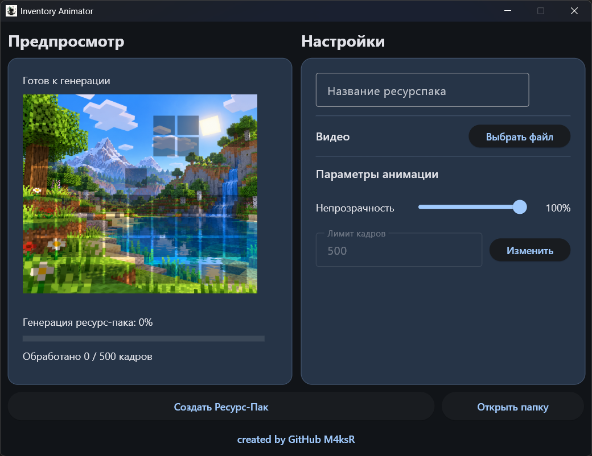

<div align="center">

  <h1 style="font-size: 100px; margin-bottom: 10px;">Inventory Animator</h1>
  <p><strong><a href="https://github.com/M4ksR/Inventory-Animator/releases/tag/v0.1.0">⬇️ Скачать Inventory Animator v0.1.0</a></strong></p>

</div>

## Описание

**Inventory Animator** — приложение для Windows, которое превращает обычное видео в анимированный ресурспак для инвентаря **Minecraft Java Edition**.



## Возможности

- Загрузка видео в форматах **MP4, AVI, MOV и MKV**.
- Настройка **непрозрачности** изображения от 0 до 100%.
- Предпросмотр непрозрачности на демонстрационной картинке с шаблоном инвентаря.
- Ограничение количества кадров.
- Отображение количества обработанных кадров и прогресса генерации.
- Автоматическая сборка ресурспака.
- Сохранение результата в `output` и кнопка быстрого открытия этой папки.

## Установка на Windows

1. Откройте [страницу релиза v0.1.0](https://github.com/M4ksR/Inventory-Animator/releases/tag/v0.1.0).
2. Скачайте файл **`InventoryAnimator.exe`** из раздела **Assets**.
3. Переместите `.exe` в папку, в которой хотите хранить результаты.
4. Запустите приложение.

## Как пользоваться

1. В поле "Название ресурспака" введите желаемое название или оставьте поле пустым.
2. Нажмите **«Выбрать файл»** и укажите видео. В случае если видео имеет формат `.gif` , то предварительно конвертируйте его в `.mp4` или любой другой разрешенный формат.
3. Отрегулируйте **непрозрачность** и при необходимости измените **лимит кадров**.
4. Нажмите **«Создать Ресурс-Пак»**.
5. Дождитесь завершения обработки.
6. Возьмите ресурспак из папки `output` и переместите его в папку `resourcepacks` в корневой папке minecraft.

> [!IMPORTANT]
> Для работы ресурспака необходимо выбрать соответствующую версию игры с OptiFine, а так же включить всю анимацию в настройках графики.

## Совместимость и ограничения

Лимит кадров в видео варьируется от 1 до 2500. Рекомендуемое значение - 500.

> [!CAUTION]
> Изменяйте лимит кадров на свой страх и риск. Слишком большое количество кадров в видео чревато долгой работой алгоритма, большим весом итогового ресурспака, а так же неспособностью minecraft загрузить текстуру.

## Сборка кода

1) Склонируйте репозиторий

```PowerShell
git clone git@github.com:M4ksR/Inventory-Animator.git
```

2) Перейдите в папку проекта

```PowerShell
cd .\Inventory-Animator\
```

3) Создайте виртуальное окружение

```PowerShell
py -m venv .venv
```

4) Активируйте его

```PowerShell
.\.venv\Scripts\Activate.ps1
```

5) Установите зависимости

```PowerShell
python -m pip install -r requirements.txt
```

6) Запустите код

```PowerShell
py main.py
```

Одной командой:

```PowerShell
git clone https://github.com/M4ksR/Inventory-Animator.git
cd Inventory-Animator
py -m venv .venv
.\.venv\Scripts\Activate.ps1
py -m pip install -r requirements.txt
py main.py
```

## Обратная связь

Сообщить об ошибке или предложить улучшение можно в [GitHub Issues](https://github.com/M4ksR/Inventory-Animator/issues).

**Автор:** [M4ksR](https://github.com/M4ksR)  

**Лицензия:** [MIT](LICENSE)
